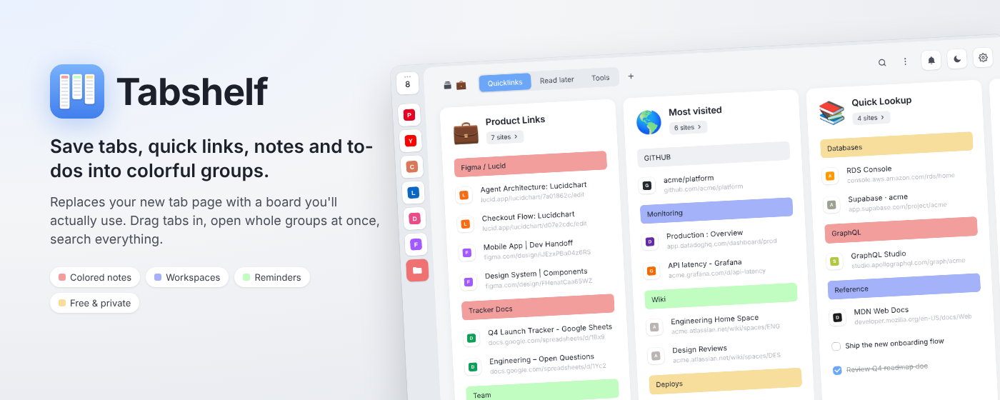
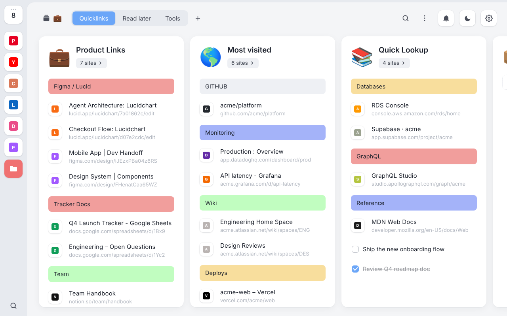
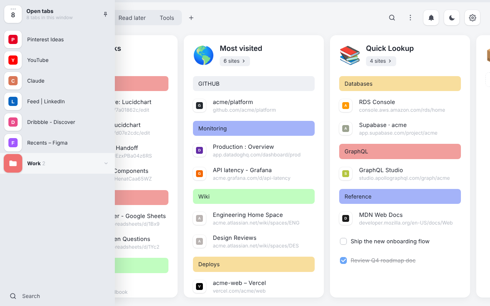
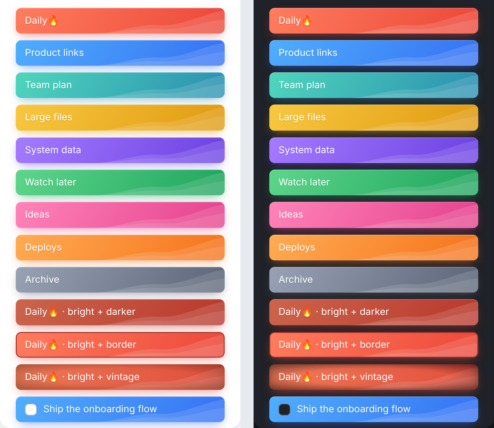

# Tabshelf

A free, private new tab board for Chrome. Save tabs, quick links, notes and to-dos into colorful groups.
Everything stays in your browser: there are no accounts, servers or tracking.

**[Download Tabshelf 2.2.0](releases/tabshelf-v2.2.0.zip)**

  
  

## Install it (2 minutes)

1. Download [`releases/tabshelf-v2.2.0.zip`](releases/tabshelf-v2.2.0.zip) and unzip it into a folder you'll keep,
   for example `~/Extensions/tabshelf`. Chrome loads the extension from that folder every time, so don't delete or move it.
   (If you cloned this repository, you can use its `extension` folder instead.)
2. Open `chrome://extensions` and switch on **Developer mode** (top right).
3. Click **Load unpacked** and choose the folder that contains `manifest.json`.
4. Open a new tab. If Chrome asks whether to keep the new tab page change, choose **Keep it**.
5. Turn off any other new tab extension on the same page. Only one can own the new tab.
6. Pin Tabshelf's icon from the puzzle-piece menu so the save popover is one click away.

New windows open on the new tab page, so they show your board too. To make Chrome start on it as well,
go to *Settings → On startup → Open the New Tab page*.

**Updating:** replace the folder's files with the new version and press ↻ on Tabshelf's card in
`chrome://extensions`. Your data is kept.

**Moving your data over:** Tabshelf can't read another extension's private storage. If your old tool exports
bookmarks HTML, use *Settings → Import bookmarks file*. Otherwise open a group's sites ("open all") and drag the
tabs from Tabshelf's sidebar into a group, or use *Save all tabs*.

## How it's organised

**Workspaces** (top-left button) hold **categories** (the tabs along the top, like Quicklinks · Read later · Tools),
which hold **groups** (the cards), which hold **items**: sites, notes, to-dos, stacks and images.

## Features

**Tabs sidebar**
- Shows every tab in this window as an icon. Hover to expand it with titles, or pin it open.
- Drag a tab into any group to save it. The tab closes; hold **Shift** while dropping to keep it open.
- Chrome tab groups appear as colored folders. Drag a folder to save the whole tab group.
- The tab-count tile at the top: add all tabs to a new group, move them into a group, save and close everything,
  and manage your other windows.

**Groups**
- An emoji or uploaded image symbol, a name (click to rename), and an **"N sites ›"** button that opens every site
  in a Chrome tab group. Shift-click opens them in a new window.
- Hover a group to type a note, paste a link or write `/todo …` in the box at the top.
- Group menu (⋯): add note, to-do or custom URL, save this window's tabs here, open all, open in new window,
  copy content, sort (A–Z, newest, oldest), move to another category or workspace, compact view, collapse, lock,
  duplicate, change symbol and delete.
- Drag the header to reorder groups or drop it on a category. Drag the right edge to resize; double-click the edge to reset widths.

**Notes and to-dos**
- Colored notes make section headers: red, orange, yellow, green, teal, blue, purple, pink or gray.
- Click a note to edit it in place. The toolbar at the bottom changes the color, toggles to-do, adds an emoji or reminder, copies or deletes it.
- **Style** in that toolbar (or *Style* in a note's right-click menu) gives a colored note a bright look (a vivid gradient with white text), a darker shade, a vintage look with a warm tone and faded dark corners, or a border. They can be combined.
- Typing shortcuts: `/todo`, `/done`, `/red`, `/green`, `/blue` … anywhere in a note; `- ` makes a bullet; `->` makes an arrow; Shift+Enter adds a new line.

**Sites, stacks and images**
- Click to open (it jumps to the tab if the site's already open). ⌘/Ctrl-click opens a new tab. Right-click for more options, including incognito and reminders.
- Drop one site onto the middle of another to **stack** them side by side. Expand a stack with its chevron.
- Drop images from web pages to save them. Drop links from any page or the address bar to save them.

**Everything else**
- **Search** (⌘K / Ctrl+K or `/`): every site, note, group, category, workspace and open tab, with web search as the fallback.
- **Reminders:** one-time, daily, weekly or monthly. Desktop notifications open the site when clicked. The bell lists what's coming up.
- **Multi-select:** Shift-click items to open, combine, move, copy or delete them together.
- **Bin:** the last 50 deleted items and groups, restorable (Ctrl+Z). Every delete also shows an Undo toast.
- **Save from any page:** the toolbar popover (Alt+Shift+U) shows where a page is already saved and lets you add a note.
  Alt+Shift+S saves straight to Read later. Right-click any page, link, image or selected text to save it into any group.
- **Settings:** light, dark or auto theme; small, medium or large items; URLs on or off; open in a new tab; jump to an open tab;
  close tabs after saving; delete drop zone; pinned sidebar.
- **Your data:** export or restore a JSON backup, import a bookmarks HTML file or a Chrome bookmarks folder, export as bookmarks HTML or CSV,
  and add a "Most visited" group.

## Keyboard shortcuts

| Action | Keys |
|---|---|
| Search everything / switch workspace | ⌘K / Ctrl+K, or `/` |
| New group | Ctrl+G |
| Open the bin | Ctrl+Z |
| Switch category | 1 – 9 |
| Select items | Shift+click |
| Keep a tab open when saving it | Shift while dropping |
| Save popover on any page | Alt+Shift+U |
| Save current page to Read later | Alt+Shift+S |

You can change the browser-level shortcuts at `chrome://extensions/shortcuts`.

## What's in this repository

| Folder or file | What it is |
|---|---|
| `extension/` | The extension's source code (Manifest V3, plain JavaScript, no build step) |
| `releases/` | The packaged zip, ready to install or upload to the Chrome Web Store |
| `store-listing/` | Store screenshots, promo tiles, icon and the listing text |
| `PUBLISHING.md` | Step-by-step guide to publishing on the Chrome Web Store |
| `PRIVACY.md` | The privacy policy |

## Privacy

Tabshelf stores everything in your browser's local extension storage and never sends it anywhere.
See [PRIVACY.md](PRIVACY.md) for details.
